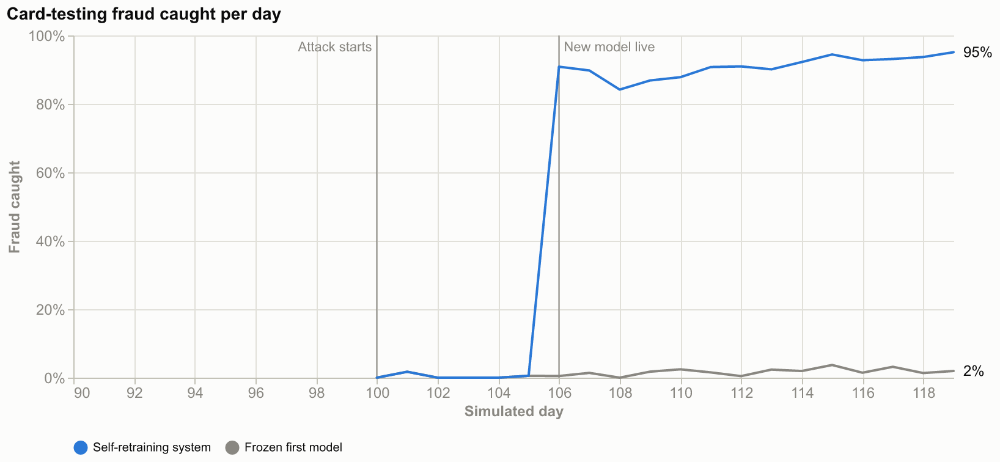
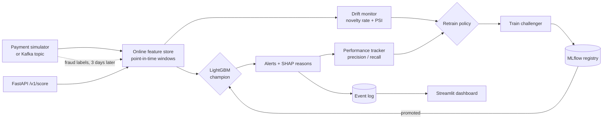

# FraudStream 🛡️

**Real-time card-fraud detection that notices when fraudsters change tactics and retrains itself.**

[](https://github.com/amnanazir101-maker/fraudstream/actions/workflows/ci.yml)


FraudStream scores card payments as they happen, explains every alert, and watches its own
inputs and results. When a new fraud pattern appears, it detects the data drift, waits for
the first fraud labels, trains a challenger model, compares it with the live model in the
MLflow registry and promotes it only if it is better. It all runs on a laptop, for free.

## Results

Every number below comes from running this repository on a laptop (`fraudstream simulate`,
`train`, `stream --day-seconds 0` and `benchmark`); runs are seeded and reproducible.



**A new attack, 30 live days.** A card-testing attack starts on day 100.

| Days | Fraud caught: self-retraining | Fraud caught: frozen first model | Card-testing fraud caught: self-retraining / frozen | Alert precision |
|---|---|---|---|---|
| 90-99, before the attack | 76% | 76% | - | 90% |
| 100-105, attack, before retraining | 36% | 36% | 0% / 0% | 90% |
| 106-119, after retraining | **87%** | 22% | **91%** / 2% | 87% |

- **Drift flagged on day 100**, the first day of the attack: "0.6% of payments have
  terminal_distance outside the training range". There were no false alarms on the 10 days before.
- **Retraining started on day 106**, as soon as three days of fraud labels had arrived. The
  challenger beat the champion on the holdout day (PR-AUC 0.96 vs 0.43) and was promoted
  automatically.

**Model quality** on simulated test days 76-89, which the model never saw in training:

| Model | PR-AUC | ROC-AUC | Precision | Recall |
|---|---|---|---|---|
| LightGBM | **0.866** | 0.952 | 91.0% | 80.4% |
| Logistic regression (baseline) | 0.718 | 0.945 | 71.8% | 72.8% |

**Real data**: the ULB credit-card fraud dataset (284,807 card payments, 0.17% fraud), split
by time. The test set is the last 20% of payments, with 75 frauds.

| Model | PR-AUC | ROC-AUC | Precision | Recall |
|---|---|---|---|---|
| LightGBM | **0.808** | 0.980 | 96.3% | 69.3% |
| Logistic regression (baseline) | 0.752 | 0.984 | 89.5% | 68.0% |

## Architecture



| Part | What it does |
|---|---|
| **Simulator** | 2,000 card holders and 5,000 terminals with spending habits and three classic fraud scenarios (large amounts, compromised terminals, compromised cards), following the ULB *Reproducible ML for Credit Card Fraud Detection* handbook. A **card-testing attack** (small night-time payments far from home) starts 10 days into the live stream. |
| **Online feature store** | 19 features: spending windows (1/7/30 days), amount vs the card's usual spend, distance from home, first visit to a terminal, and terminal fraud risk. Fraud labels arrive 3 days after a payment, as investigations take time, so terminal risk only uses labels that have arrived. Training replays history through the **same code**, so there is no training/serving skew and no look-ahead leakage. |
| **Model** | LightGBM with early stopping on a time-ordered split, compared with a logistic-regression baseline. The alert threshold maximises F1 on validation days. Each alert carries its top reasons (SHAP values from LightGBM). |
| **Registry** | Every model is an MLflow run and a registered version. The live one carries the `champion` alias. |
| **Monitoring** | Two daily drift tests per feature against the training data: the share of payments outside the training range (catches a new pattern on day one) and the population stability index (broad shifts). Daily precision and recall once the labels are in, for the live model and for a frozen copy of the first model (shadow scoring). |
| **Retraining** | When drift is confirmed and enough fully labelled days exist, or the live model's recall falls, a challenger is trained on the last 60 labelled days, tested against the champion on the newest labelled day, and promoted only if it wins. A cooldown stops back-to-back retraining. |
| **Serving** | FastAPI scoring API with explanations, label feedback and Prometheus metrics. Kafka transport for the stream (one ordered topic). A Streamlit dashboard follows the stream live. |

## Quickstart

```bash
git clone https://github.com/amnanazir101-maker/fraudstream.git
cd fraudstream
python -m venv .venv
.venv\Scripts\activate             # macOS/Linux: source .venv/bin/activate
pip install -e ".[dashboard,dev]"

fraudstream simulate               # world + 90 days of payment history
fraudstream train                  # features, LightGBM vs baseline, MLflow registry
fraudstream stream                 # 30 live days; the attack starts on day 100
```

In a second terminal, open the live dashboard:

```bash
streamlit run dashboard.py
```

| Command | What it does |
|---|---|
| `fraudstream stream --day-seconds 0` | run the stream at full speed (no pacing) |
| `fraudstream serve` | scoring API at http://127.0.0.1:8000/docs |
| `fraudstream benchmark` | train and test on the real ULB credit-card dataset (downloads 73 MB once) |
| `mlflow ui --backend-store-uri sqlite:///data/mlflow.db` | browse runs and model versions at http://127.0.0.1:5000 |
| `docker compose up --build` | the full system with Kafka, the scorer, the API, the dashboard and MLflow |

### Score a payment

```bash
curl -X POST http://127.0.0.1:8000/v1/score -H "Content-Type: application/json" \
     -d '{"customer_id": 42, "terminal_id": 1337, "amount": 950}'
```

```json
{"transaction_id": 9000000001, "fraud_probability": 0.99659, "alert": true,
 "threshold": 0.33167, "model_version": "2",
 "reasons": [{"feature": "amount_to_avg_30d", "value": 16.781, "impact": 6.853},
             {"feature": "amount", "value": 950.0, "impact": 2.648},
             {"feature": "cust_avg_amount_7d", "value": 97.058, "impact": 1.027}]}
```

The payment is 16.8 times this card's usual amount, which is the main reason for the alert.
`/metrics` exposes Prometheus counters (payments scored, alerts, latency, model version).

## Project structure

```
src/fraudstream/
  simulator.py    card holders, terminals, payments, fraud scenarios, the card-testing attack
  features.py     online feature store (point-in-time windows, delayed labels) and replay
  model.py        LightGBM training, baseline, threshold, SHAP explanations
  registry.py     MLflow tracking and model registry (champion alias)
  monitoring.py   drift tests (novelty rate, population stability index), retraining policy
  streaming.py    live event stream, scoring, monitoring, retraining, run summary
  charts.py       dashboard charts (Altair)
  api.py          FastAPI scoring service with Prometheus metrics
  kafka.py        Kafka producer and consumer
  benchmark.py    evaluation on the real ULB credit-card dataset
  pipeline.py     simulate, build features, train the first model
  cli.py          the `fraudstream` command
dashboard.py      Streamlit live dashboard
tests/            unit, end-to-end and Kafka tests
```

## Tests

```bash
pytest
```

The tests check the feature store against a brute-force computation (no look-ahead), the
simulator's determinism, both drift tests and the retraining policy, training and the MLflow
registry, the API, the dashboard, and a full stream in which the attack must be flagged on its
first day and a retrained model must catch it. In CI a Kafka service container runs a
round-trip test, and the Docker image is built.

## Design notes

- **Why a simulator.** Card transactions are confidential, so the live stream comes from the
  transaction simulator of the ULB *Reproducible ML for Credit Card Fraud Detection* handbook,
  extended with a card-testing attack. It reproduces what makes fraud detection hard (labels
  that arrive days later, compromised terminals and cards, a tactic that appears overnight)
  and makes every run reproducible. The model is also tested on real card payments (the ULB
  benchmark above).
- **Two speeds of defence.** Drift detection needs no labels, so it raises the alarm on the
  attack's first day; retraining waits for three days of fraud labels so the challenger can
  learn the new pattern.
- **Roadmap.** A Redis-backed online feature store and a remote MLflow tracking server for
  running several scorer instances.

## Author

Built by **Amna Nazir** ([@amnanazir101-maker](https://github.com/amnanazir101-maker)).

## License

[MIT](LICENSE)
